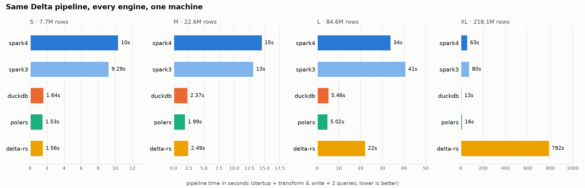
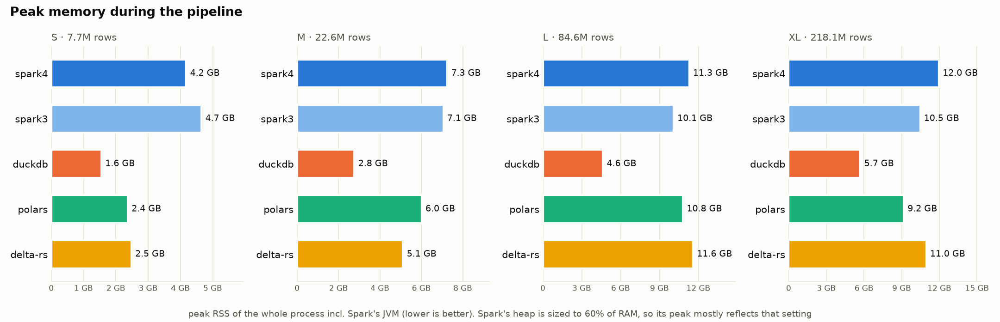

# pipeline-engine-bench

**One Delta Lake pipeline, four engines, one machine. When do you actually need Spark?**

This repo runs the *same* bronze → silver → gold pipeline on **Apache Spark**, **DuckDB**,
**Polars** and **delta-rs** over the same local Delta tables, at four data sizes (7.7M → 218M rows),
and records wall-clock time, peak memory of the whole process tree (JVM included), and — above all —
**whether each engine got the right answer**. Every run is checked against a reference computed
without any of the benchmarked engines or their SQL; a run that gets the wrong answer doesn't count,
however fast it was.

**Short answer to the title:** for data that fits on one machine — up to 218M rows here — you don't.
DuckDB and Polars run the whole pipeline in seconds; Spark pays a 5–6× tax it only begins to claw
back at the largest size. The numbers, caveats and a few surprises are below.

---

## Results

One run on a MacBook (macOS, 14 cores, 24 GB RAM), 3 repeats per engine × tier, source
**NYC TLC** yellow-taxi data (2019 for S/M/L; 2019–2023 for XL). Spark is shown at two versions —
**4.0.1** (on Java 21) and **3.5.3** (on Java 17). Full tables and environment under
[`results/`](results/). Your numbers will differ — see
[Fairness notes](docs/method.md#fairness-notes-read-before-quoting-numbers).

**Pipeline time** — `startup + transform_write + aggregate + top_zones`, median of 3 valid runs:

| Tier | Rows | DuckDB | Polars | delta-rs | Spark 4 | Spark 3 |
|---|---:|---:|---:|---:|---:|---:|
| S | 7.7M | 1.6s | 1.5s | 1.6s | 10s | 9.3s |
| M | 22.6M | 2.4s | 2.0s | 2.5s | 15s | 13s |
| L | 84.6M | 5.5s | 5.0s | 22s | 34s | 41s |
| XL | 218.1M | 13s | 16s | **792s** | 63s | 80s |



- **You don't need Spark on one machine, even at 218M rows.** DuckDB and Polars finish the whole
  pipeline in ~5s at L (84.6M rows) and ~13–16s at XL (218M); Spark takes 34s and 63s. DuckDB and
  Polars win at every size tested.
- **Spark's gap stays wide through L, then narrows at XL.** Spark is a flat 6.2–6.3× slower than
  DuckDB through L — not startup-dominated (startup is only ~3s of Spark's 10s at S), just a higher
  per-row cost. Only at XL does the ratio fall, to 4.9×, the first sign Spark's fixed costs amortize.
  The crossover where Spark pays off sits beyond one machine, not within the sizes most jobs hit.
  (The Spark figures above are Spark 4.0.1.)
- **Spark 4 beats Spark 3 only at scale.** On the small tiers the two are within noise — Spark 3 is
  even a hair faster (S 9.3s vs 10s, M 13s vs 15s) — but Spark 4's engine work pays off as data
  grows: ~17% faster at L (34s vs 41s) and ~21% at XL (63s vs 80s). Neither version comes close to
  DuckDB or Polars on one machine, so the version choice doesn't change the headline.
- **delta-rs scales worst of the fast engines — and the cause is its query path, not Delta writes.**
  It tracks DuckDB/Polars at S and M, then jumps to 22s at L and **792s at XL** (~60× slower than
  DuckDB), almost all of it in `transform_write`. DuckDB writes its silver table through the *same*
  delta-rs writer and finishes that stage in 4.7s (L) / 11s (XL) — so the slowdown is in delta-rs's
  embedded DataFusion execution of the joins (`QueryBuilder`), not in writing Delta.
- **Only 3 of 4 engines can MERGE into Delta.** Spark, delta-rs and Polars can; DuckDB's `delta`
  extension can INSERT but not MERGE/UPDATE, so its MERGE is `n/a`. Polars delegates its writes and
  MERGE to delta-rs, so those two share a code path (and near-identical MERGE bars).
- **Spark's memory number is mostly its heap setting.** At L, Spark peaks at 11.3 GB on the default
  (60% of RAM) but 4.9 GB under `SPARK_DRIVER_MEMORY=4g` — at the *same* pipeline time. Nothing is
  OOM-killed even at XL (macOS swaps instead): there Spark peaks at 12.0 GB, delta-rs 11.0, polars
  9.2, and DuckDB stays leanest (5.7 GB).



Every run above passed its correctness check (`3/3` valid) against an engine-independent reference —
a fast wrong answer wouldn't have counted. See
[`bench-20261012-all/summary.md`](results/bench-20261012-all/summary.md) for the full per-stage
breakdown of all four tiers, and the [`-spark3`](results/bench-20261012-spark3/) /
[`-spark4g`](results/bench-20261012-spark4g/) / [`-polarsauto`](results/bench-20261012-polarsauto/)
folders for the Spark 3, constrained-Spark and default-Polars comparison runs.

---

## Quick start

Requirements: Python 3.10+, **Java 17 or 21** (for Spark), internet access to PyPI and Maven Central
(Spark downloads the Delta jars on first run). On macOS with Homebrew's keg-only `openjdk@21`, export
`JAVA_HOME` before any Spark command (`make smoke`/`bench`/`bench-xl`):
`export JAVA_HOME="$(brew --prefix openjdk@21)/libexec/openjdk.jdk/Contents/Home"`.

```bash
git clone https://github.com/pallavi-chandrashekar/pipeline-engine-bench
cd pipeline-engine-bench
make setup          # .venv + dependencies
make test           # offline tests on synthetic data
make smoke          # 2M synthetic rows through all 4 engines, incl. Spark + Delta

make data-S SOURCE=tlc && make data-M SOURCE=tlc && make data-L SOURCE=tlc
make bench          # S, M, L x 4 engines x 3 repeats
make data-XL SOURCE=tlc && make bench-xl   # optional XL tier (~40 GB disk)
```

Ingest prints, per file, how many rows were kept and any columns that came out NULL after casting —
check those lines the first time. To pull from an unpartitioned shared table instead of TLC:
`make list-share` to see what's offered, then `BENCH_SHARE_TABLE=share.schema.table make data-S`
(dropping `SOURCE=tlc`); see [why the default open share doesn't fit](docs/pipeline.md#data-tiers).

Useful knobs:

```bash
.venv/bin/python -m bench.harness --tiers S --engines duckdb,polars --stages aggregate,top_zones --repeats 5
SPARK_DRIVER_MEMORY=12g make bench                                   # default: 60% of RAM
SPARK_EXTRA_CONF='{"spark.sql.shuffle.partitions":"16"}' make bench  # tuned Spark run
POLARS_ENGINE=auto make bench                                        # Polars' default engine
```

These settings are recorded in each run's `env.json` and `summary.md`.

---

## Learn more

- **[The pipeline & data tiers](docs/pipeline.md)** — the bronze → silver → gold stages, the shared
  SQL, and where the data comes from.
- **[Method & fairness notes](docs/method.md)** — how time, memory and correctness are measured, and
  the caveats to read before quoting any number.
- **[Development](DEVELOPMENT.md)** — architecture, repo layout, and how to add an engine.
- **[Plan](PLAN.md)** — status and next steps. **[`results/`](results/)** — every run's tables,
  CSVs, charts and `env.json`.

## License

MIT. Data: NYC TLC trip records are published by the NYC Taxi & Limousine Commission and are
subject to its terms of use.
