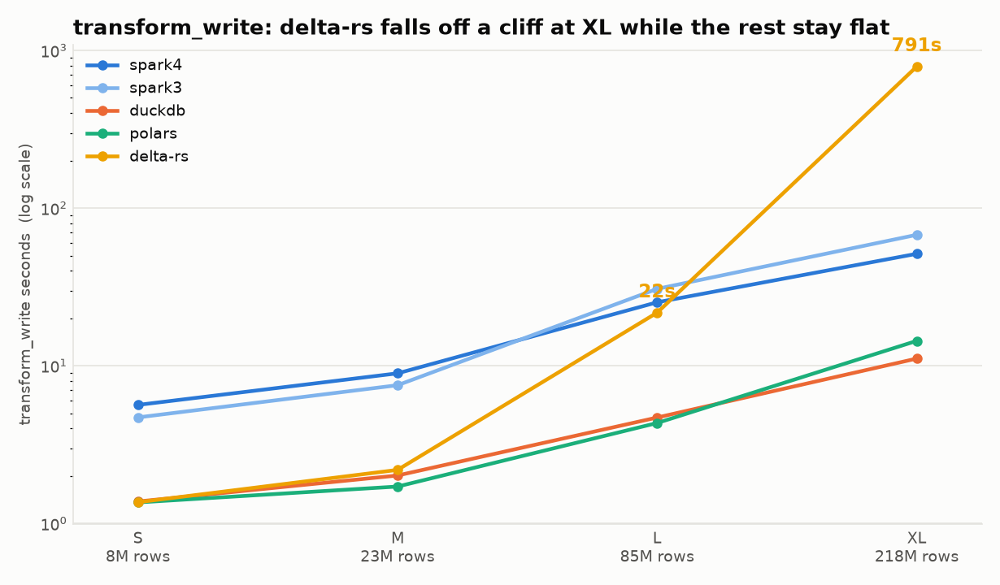
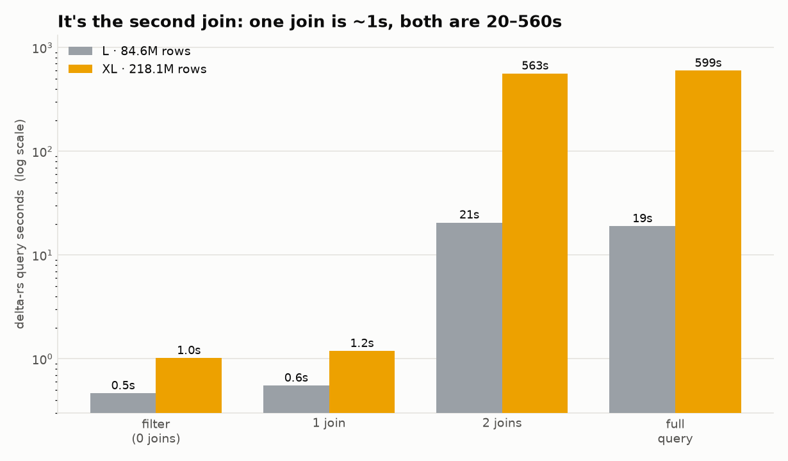

# Investigation: why delta-rs slows down ~36× from L to XL

[← back to README](../README.md)

## The question

In `bench-20261012-all`, delta-rs keeps pace with DuckDB and Polars at S and M, then falls off a cliff:

| Tier | Rows | delta-rs transform_write | DuckDB transform_write |
|---|---:|---:|---:|
| S | 7.7M | 1.36s | 1.38s |
| M | 22.6M | 2.19s | 2.01s |
| L | 84.6M | 22s | 4.70s |
| XL | 218.1M | 791s | 11s |

From L to XL, rows grow 2.6× but delta-rs's time grows ~36×. Its other stages stay fast (aggregate
0.86s, top_zones 0.64s, MERGE 27s — the same as Polars, which also writes through delta-rs).



## What was proven before this, and what wasn't

**Proven by the benchmark results**

- 791 of delta-rs's 792 pipeline seconds at XL are in `transform_write`.
- The Delta writer is not slow in general: DuckDB passes its result to the same `write_deltalake` and
  finishes the stage in 11s.

**Not yet proven.** `DeltaRsEngine.transform_write` runs the query and the write in one line, so they
are timed together:

```python
write_deltalake(out_path, self.qb.execute(W.SILVER_SQL), ...)
```

The README said the slowdown was "in delta-rs's embedded DataFusion execution of the joins." A
reasonable deduction — but not a measurement, and with a plausible rival: on a 24 GB Mac, where macOS
swaps instead of failing, a 36× slowdown from 2.6× more data looks a lot like **memory pressure**.

## Hypotheses

| # | Hypothesis | What would show it |
|---|---|---|
| H1 | DataFusion's join execution is CPU-bound slow at this size | `query_only` ≈ e2e time, with little swap |
| H2 | Memory pressure: the query holds too much, macOS swaps, everything slows | `query_only` slow **and** large swap growth |
| H3 | The query doesn't truly stream (computes everything before the first batch) | `first_batch_s` ≈ `query_only` seconds |
| H4 | The writer is slow only when fed by delta-rs's stream | `query_only` fast but `deltars_e2e` slow |
| H6 | A specific join (or the number of joins) causes it | an `ablate_*` variant isolates it |

## The tool: `bench/diagnose_deltars.py`

Each experiment runs in its own subprocess (so its peak RSS and swap are its own) and records wall
time, time to the first batch, rows, output file count, peak RSS of the process tree, and **swap
growth** (macOS `vm.swapusage`).

| Experiment | What it isolates |
|---|---|
| `probe` | what `qb.execute` returns + seconds to the **first** batch (H3) |
| `query_only` | delta-rs query, batches drained, no write (H1, H2) |
| `write_only` | `write_deltalake` on a pre-computed silver parquet, no query (H4) |
| `deltars_e2e` | the benchmark's exact query+write path (baseline) |
| `duckdb_e2e` | DuckDB query + the same writer (reference) |
| `ablate_filter` | the filter only, no joins |
| `ablate_inner` / `ablate_left` | exactly **one** join |
| `ablate_bothjoins` | **both** joins but no year/month `EXTRACT` (two-join plan vs the scalars) |

Run it:

```bash
make diagnose TIER=L            # quick first pass (~90s)
make diagnose TIER=XL           # the real test; the three big experiments take ~13 min each
# or narrow it:
.venv/bin/python -m bench.diagnose_deltars --tier XL --experiments query_only,ablate_bothjoins
```

Before XL: close other heavy apps (so swap reflects the workload), and keep a few GB free —
`write_only` caches a one-time reference silver parquet under `data/tiers/XL/_diag/`, and each write
experiment writes a silver table before deleting it. Results land in
`results/diag-<date>-<tier>/{diagnose.md,diagnose.csv}`.

## Findings



The two charts above are generated by `python -m bench.diagnose_charts`.

### L (84.6M rows) — measured, reproducible

| Query | Time | Peak RSS |
|---|---:|---:|
| `ablate_filter` (no joins) | 0.47s | 1.5 GB |
| `ablate_inner` (one join) | 0.55s | 1.6 GB |
| `ablate_left` (one join) | 0.54s | 1.5 GB |
| `ablate_bothjoins` (both joins, no EXTRACT) | **20.6s** | **11.3 GB** |
| `query_only` (full silver query) | 19.0s | 12.2 GB |
| `write_only` (writer alone) | 3.5s | 12.4 GB |
| `duckdb_e2e` (DuckDB query + same writer) | 4.6s | 5.1 GB |
| `deltars_e2e` (query + write, the benchmark path) | 24.0s | 10.7 GB |

**Conclusion (L):**

- **It's the query, not the write.** `query_only` (19s) is nearly the whole `deltars_e2e` (24s);
  `write_only` is 3.5s and DuckDB does query+write in 4.6s. H4 ruled out; the README was right that
  writes aren't the problem.
- **It's the *second* join, not "joins" in general, and not the `EXTRACT`.** One join to the 265-row
  `zones` table is trivial (~0.5s, 1.6 GB). Adding the second join explodes it ~36× in time
  (0.5s → 20s) and ~7× in memory (1.6 → 11 GB). Dropping the year/month `EXTRACT` changes nothing
  (`ablate_bothjoins` ≈ `query_only`).
- **Not memory pressure.** Swap growth stayed under ~150 MB throughout, with RSS ~11–12 GB on a 24 GB
  machine. H2 ruled out — it's a planning/execution pathology, not swapping.
- **It does stream.** First batch arrives at ~2.6s of a 19s query, so H3 is ruled out too.

The shape points at delta-rs's embedded DataFusion building a pathological plan for two joins against
the same tiny dimension table — most likely repartitioning the 84M-row trips side for the second join
instead of broadcasting the 265-row `zones` table (consistent with the ~7× memory blow-up).

### XL (218.1M rows) — measured (`results/diag-20261104-XL/`)

| Query (214M rows out) | Time | First batch | Peak RSS | Swap growth |
|---|---:|---:|---:|---:|
| `ablate_filter` (no joins) | 1.0s | 0.05s | 1.6 GB | 0 |
| `ablate_inner` (one join) | 1.2s | 0.04s | 1.8 GB | 0 |
| `ablate_left` (one join) | 1.1s | 0.04s | 1.8 GB | 0 |
| `ablate_bothjoins` (both joins) | **563s** | 98s | **13.2 GB** | **+8.8 GB** |
| `query_only` (full query) | 599s | 134s | 13.0 GB | +5.9 GB |
| `write_only` (writer alone) | 9.6s | — | 13.6 GB | — |
| `duckdb_e2e` (DuckDB + same writer) | 10.6s | — | 6.5 GB | — |
| `deltars_e2e` (query + write) | 677s | — | 13.7 GB | +6.3 GB |

**Conclusion (XL):** the L pattern holds and intensifies. The write path is still fine (9.6s;
DuckDB does query+write in 10.6s). One join is ~1s; the **second** join takes it to 563s — a ~470×
jump — and `query_only` ≈ `deltars_e2e`, so it's the query, not the write.

**What's new at XL: memory pressure arrives.** At L the two-join query used ~11 GB with <150 MB swap
(CPU-bound). At XL it peaks at 13 GB and pushes **~6–9 GB into swap** on the 24 GB machine, and the
first batch is delayed ~100–134s — it stops streaming and materializes a large intermediate. So at
the headline size the slowdown is a **compound**: a pathological two-join plan that **also doesn't
spill well**, exactly the "H1 + H2 together" outcome.

### Bottom line

- Not the writer (proven at both sizes).
- Not "joins" in general, and not the `EXTRACT` scalars — specifically the **second join** to the
  tiny `zones` table: one join ≈ 0.5–1s, two joins blow up ~36× (L) to ~470× (XL).
- Memory is not the cause at L but becomes a major compounding factor at XL (6–9 GB swap).

## Follow-ups

- **Confirm the mechanism upstream:** run the same two-join SQL on *standalone* `datafusion` (and
  record its version vs the one `deltalake` 1.6.6 embeds). If standalone is also slow, it's DataFusion;
  if not, it's delta-rs's wrapper. A linked delta-rs / DataFusion issue with the minimal repro would
  strengthen the finding.
- **Try a cheaper plan:** fewer columns than `t.*`, or a broadcast hint if the API exposes one, and see
  whether the second-join cliff disappears.

## What this changes in the repo

1. Commit `results/diag-*` (the evidence).
2. Correct the delta-rs bullet in `README.md` so the stated cause matches what was measured — "the
   second join to the same table," not just "the joins" — and link here.
3. Record it in `PLAN.md`.
